

<a href="https://benibix.com"><picture><source media="(prefers-color-scheme: dark)" srcset="assets/hero-dark.svg"></picture></a>
  
<a href="https://tools.benibix.com"><picture><source media="(prefers-color-scheme: dark)" srcset="assets/btn-tools-dark.svg"></picture></a>
<a href="https://tools.benibix.com/tutorials/"><picture><source media="(prefers-color-scheme: dark)" srcset="assets/btn-courses-dark.svg"></picture></a>
<a href="https://benibix.com/about/"><picture><source media="(prefers-color-scheme: dark)" srcset="assets/btn-about-dark.svg"></picture></a>
<a href="https://www.linkedin.com/in/behnia-zarei"><picture><source media="(prefers-color-scheme: dark)" srcset="assets/btn-linkedin-dark.svg"></picture></a>
<a href="https://www.youtube.com/@benibix"><picture><source media="(prefers-color-scheme: dark)" srcset="assets/btn-youtube-dark.svg"></picture></a>
  
<picture><source media="(prefers-color-scheme: dark)" srcset="assets/h-work-dark.svg"></picture>
<picture><source media="(prefers-color-scheme: dark)" srcset="assets/work-dark.svg">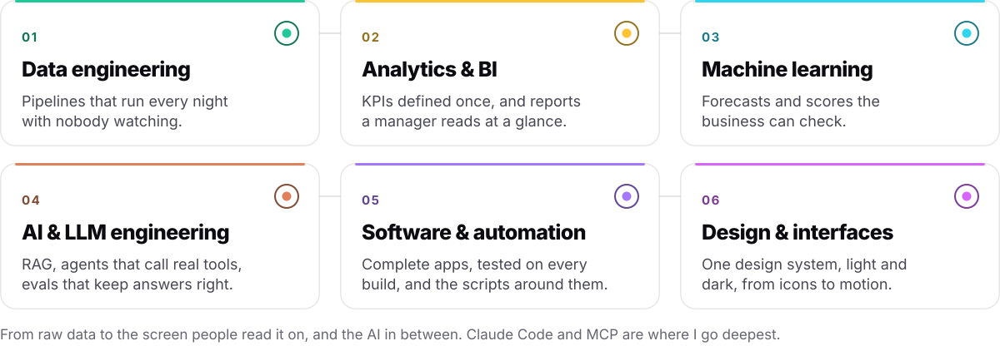</picture>
  
<a href="https://tools.benibix.com"><picture><source media="(prefers-color-scheme: dark)" srcset="assets/h-tools-dark.svg"></picture></a>
<picture><source media="(prefers-color-scheme: dark)" srcset="assets/numbers-dark.svg">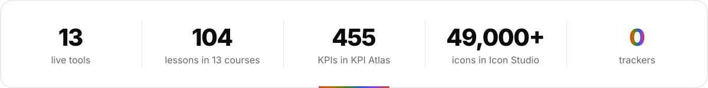</picture>
  
<picture><source media="(prefers-color-scheme: dark)" srcset="assets/row-coding-agents-claude-code-dark.svg"></picture> 
<a href="https://tools.benibix.com/coding-agents/claude-code/config-studio/"><picture><source media="(prefers-color-scheme: dark)" srcset="assets/tile-coding-agents-claude-code-config-studio-dark.svg"></picture></a><a href="https://tools.benibix.com/coding-agents/claude-code/statusline-studio/"><picture><source media="(prefers-color-scheme: dark)" srcset="assets/tile-coding-agents-claude-code-statusline-studio-dark.svg"></picture></a><a href="https://tools.benibix.com/coding-agents/claude-code/usage-insights/"><picture><source media="(prefers-color-scheme: dark)" srcset="assets/tile-coding-agents-claude-code-usage-insights-dark.svg"></picture></a>
  
<picture><source media="(prefers-color-scheme: dark)" srcset="assets/row-coding-agents-codex-dark.svg"></picture> 
<a href="https://tools.benibix.com/coding-agents/codex/config-studio/"><picture><source media="(prefers-color-scheme: dark)" srcset="assets/tile-coding-agents-codex-config-studio-dark.svg"></picture></a><a href="https://tools.benibix.com/coding-agents/codex/usage-insights/"><picture><source media="(prefers-color-scheme: dark)" srcset="assets/tile-coding-agents-codex-usage-insights-dark.svg"></picture></a>
  
<picture><source media="(prefers-color-scheme: dark)" srcset="assets/row-prompts-github-dark.svg"></picture> 
<a href="https://tools.benibix.com/prompts/character-prompt-builder/"><picture><source media="(prefers-color-scheme: dark)" srcset="assets/tile-prompts-character-prompt-builder-dark.svg"></picture></a><a href="https://tools.benibix.com/prompts/prompt-gallery/"><picture><source media="(prefers-color-scheme: dark)" srcset="assets/tile-prompts-prompt-gallery-dark.svg"></picture></a><a href="https://tools.benibix.com/github/profile-readme-studio/"><picture><source media="(prefers-color-scheme: dark)" srcset="assets/tile-github-profile-readme-studio-dark.svg"></picture></a>
  
<picture><source media="(prefers-color-scheme: dark)" srcset="assets/row-data-dark.svg"></picture> 
<a href="https://tools.benibix.com/data/chart-compass/"><picture><source media="(prefers-color-scheme: dark)" srcset="assets/tile-data-chart-compass-dark.svg"></picture></a><a href="https://tools.benibix.com/data/kpi-atlas/"><picture><source media="(prefers-color-scheme: dark)" srcset="assets/tile-data-kpi-atlas-dark.svg"></picture></a><a href="https://tools.benibix.com/data/report-design-studio/"><picture><source media="(prefers-color-scheme: dark)" srcset="assets/tile-data-report-design-studio-dark.svg"></picture></a>
  
<picture><source media="(prefers-color-scheme: dark)" srcset="assets/row-design-dark.svg"></picture> 
<a href="https://tools.benibix.com/design/icon-studio/"><picture><source media="(prefers-color-scheme: dark)" srcset="assets/tile-design-icon-studio-dark.svg"></picture></a><a href="https://tools.benibix.com/design/motion-studio/"><picture><source media="(prefers-color-scheme: dark)" srcset="assets/tile-design-motion-studio-dark.svg"></picture></a>
  
<picture><source media="(prefers-color-scheme: dark)" srcset="assets/h-build-dark.svg"></picture>
<picture><source media="(prefers-color-scheme: dark)" srcset="assets/build-dark.svg">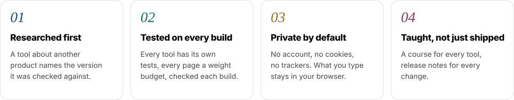</picture>
  

Found a bug or have an idea for a tool? <a href="https://github.com/behnia137/benibix-feedback/issues">Open an issue</a>, I read every one. These pictures are drawn by <code>scripts/gen.mjs</code> from the site's own data.

